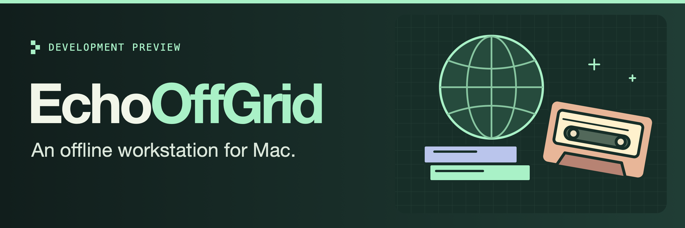
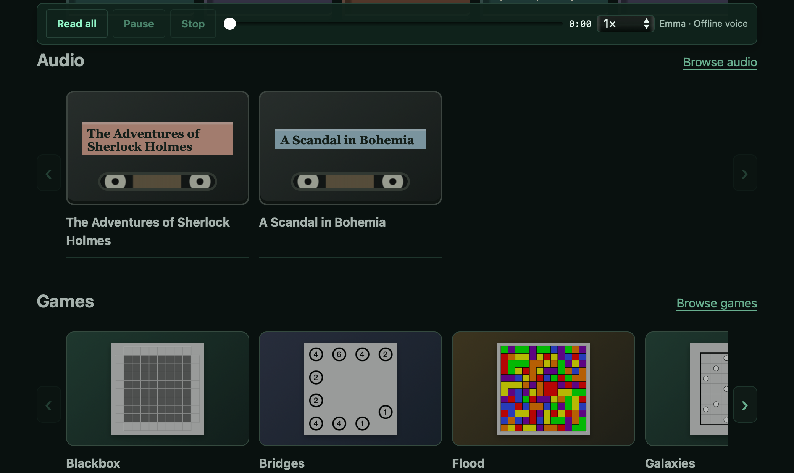

# EchoOffGrid



**A library you can disconnect.** Open Wikipedia, find a word, read a saved article or pick a video from the shelf. EchoOffGrid keeps the files on your device and can sync a Mac and an Android phone when they meet again.

**Active development · Apple Silicon macOS 15+ · arm64 Android preview**



## First launch

For the packaged preview, open **EchoOffGrid.pkg** on a Mac or install **EchoOffGrid-arm64.apk** on Android. Open **Wikipedia** and search for *ocean*. The preview packages include the Simple English Wikipedia mini archive, a starter English dictionary, a world overview map, illustrated field notes and sample media. The wiki contains article introductions. Larger ZIM collections can be connected separately. Each device can open its starter library before it is paired.

| Open | What you can do |
| --- | --- |
| **Library** | Browse videos, shows, audio, books, pictures, games and software. Open a category for its full grid, import personal files or browse publishers. Local videos have native playback controls and optional autoplay. |
| **News and Discover** | Read the illustrated field notes immediately. While connected, choose a regional news edition, refresh world news, and browse public catalogues. Saved articles and previously cached artwork stay on the device. |
| **Reference and maps** | Browse Wikipedia, look up highlighted words, explore a map and listen with the packaged English narrator. Map detail depends on the tile archives installed. |
| **Private Browser** | Browse HTTPS sites through Tor in a separate in-app view while online. Other apps use their existing connection. |
| **EchoLite** | The Mac hosts the supplied EchoLite interface. Android opens the independently installed EchoLite app and Back returns to EchoOffGrid. EchoLite owns its models and settings. |
| **Devices** | Pair a Mac and phone over USB and sync compatible content over USB or Wi-Fi. Import optional radio logs and compare local observations with public ScotMesh reports. |

## Run the source preview on a Mac

Install Python 3.11 or newer with SQLite FTS5 support. From the checkout, run the following command. On first run it fetches and verifies about 506 MiB of Wikipedia data. Keep the terminal open and visit the localhost address it prints. The packaged Mac app includes the interpreter and the archive.

```sh
./Start-EchoOffGrid.command
```

For device pairing, Android build prerequisites and Mac installer details, see the [Android guide](docs/android.md) and [workstation guide](docs/workstation-guide.md).

## Next stage

**Peer-to-peer and mesh networking** is the next development stage. Today’s transport connects a paired Mac and phone directly. The proposed next step is exchanging selected offline content between trusted peers and testing what can reasonably travel over a low-bandwidth mesh. Multi-hop forwarding and radio-based library sync are planned work. [Networking roadmap](docs/roadmap.md)

## Help test

Try a cold launch with Wi-Fi off. Open an article, a map and a video, then tell us which device and build you used and the first step that failed. The Mac preview uses ad-hoc signing and the Android APK uses a local review key.

EchoOffGrid’s code uses the MIT licence. Bundled data, media and third-party tools retain their own terms. [Licence](LICENSE) · [Third-party notices](THIRD_PARTY.md)
